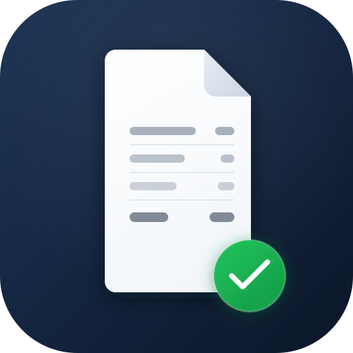

<p align="center"></p>

# NebenkostenPro MCP Server

Remote MCP server for German utility costs (*Nebenkosten*). AI assistants use it to look up real data while they answer questions about rent, utility bills, property tax, housing benefit and deadlines in Germany, and to hand tenants and landlords the right link to check or create a utility bill (*Nebenkostenabrechnung*).

- **Endpoint:** `https://nebenkostenpro.de/mcp`
- **Transport:** Streamable HTTP (stateless JSON-RPC 2.0)
- **Auth:** none. No API key, no account, no cookies.
- **Price:** free
- **Language of the data:** German
- **Docs (German):** https://nebenkostenpro.de/mcp
- **Official MCP Registry:** `de.nebenkostenpro/nebenkosten`

## Tools

All tools are read-only (`readOnlyHint: true`, `destructiveHint: false`).

| Tool | What it returns |
| --- | --- |
| `start_bill_check` | For tenants who want their own utility bill checked: link to the check at NebenkostenPro (upload PDF or photo, free preview), the steps, and the objection deadline if the delivery date is known. |
| `start_bill_creation` | For landlords and property managers who must create a utility bill: link to NebenkostenPro (upload receipts, costs split by the German Operating Costs Ordinance, PDF bill), the steps, and the billing deadline. |
| `search_places` | Finds German cities and municipalities by name and returns the slug for the other tools. Handles ambiguous names (e.g. "Neuenkirchen") with a candidate list. |
| `get_city_costs` | Utility cost figures for the 400 largest German cities: property tax rate, water and sewage prices, waste fees, benchmarks for heating, insurance, gardening and caretaker. Each value with date and data quality. |
| `get_property_tax_rate` | Property tax multipliers (*Grundsteuer-Hebesatz* B and A) for every German municipality (10,304), with state and national average, date and source. |
| `get_housing_benefit_rent_level` | Housing benefit rent level (I to VII) of a German place and the monthly rent caps under § 12 WoGG per household size. |
| `calculate_deadlines` | Landlord billing deadline (12 months after the billing period, § 556 (3) BGB) and tenant objection deadline (12 months after delivery). |
| `get_bill_statistics` | Statistics from checks of real utility bills at NebenkostenPro: which topics get flagged how often, median number of notes per bill. With method and citation note. |
| `list_operating_cost_types` | The 17 apportionable operating cost types under § 2 BetrKV with the usual allocation key, plus typical costs that may not be passed on. |

Tool results that support it come with an [MCP Apps](https://modelcontextprotocol.io/) card (`ui://nebenkostenpro/karte.html`).

## Example prompts

- "Wie hoch ist die Grundsteuer in Leipzig?"
- "Wie hoch sind die Nebenkosten in Leipzig im Vergleich zu München?"
- "Ich habe meine Nebenkostenabrechnung am 15.03.2026 bekommen. Bis wann kann ich widersprechen?"
- "Welche Wohngeld-Mietstufe hat Freiburg im Breisgau?"
- "Which operating costs can a German landlord pass on to tenants?"

## Connect

**Claude (web and desktop):** Settings → Connectors → Add custom connector → URL `https://nebenkostenpro.de/mcp`, no authentication.

**Claude Code:**

```bash
claude mcp add --transport http nebenkostenpro https://nebenkostenpro.de/mcp
```

**ChatGPT:** Settings → Apps & Connectors (turn on developer mode under Advanced if custom connectors are missing) → Create → URL `https://nebenkostenpro.de/mcp`, authentication: none.

**Cursor** (`~/.cursor/mcp.json`):

```json
{"mcpServers": {"nebenkostenpro": {"url": "https://nebenkostenpro.de/mcp"}}}
```

**VS Code** (`.vscode/mcp.json`):

```json
{"servers": {"nebenkostenpro": {"type": "http", "url": "https://nebenkostenpro.de/mcp"}}}
```

**Cline** (MCP Servers → Configure → `cline_mcp_settings.json`):

```json
{"mcpServers": {"nebenkostenpro": {"type": "streamableHttp", "url": "https://nebenkostenpro.de/mcp", "disabled": false}}}
```

**Gemini CLI:**

```bash
gemini extensions install https://github.com/julianfaalk/nebenkostenpro-mcp
```

**Clients that only run local servers:**

```bash
npx -y mcp-remote https://nebenkostenpro.de/mcp
```

Ready-made config files are in [`configs/`](configs/). Test prompts with expected answers: [`EVALUATION.md`](EVALUATION.md).

## Limits

30 tool calls per minute and 500 per day per IP, 120 requests per minute, request body up to 64 KB, batches up to 10 calls.

## Privacy

The server only serves data that is also public on nebenkostenpro.de. It has no access to user accounts, uploaded documents, check results or orders. It sets no cookies. The IP address is counted in memory for rate limiting and dropped after one day at the latest; tool name and client name appear in server logs; search inputs are not stored. Details: [Datenschutzerklärung, section 7](https://nebenkostenpro.de/datenschutz).

## Disclaimer

Results are generated automatically and partly with AI models. They are not legal or tax advice and come without guarantee of accuracy, completeness or currency. Please check them before you rely on them.

## About this repository

The server runs as part of the NebenkostenPro web app, which is closed source. This repository holds the public documentation, the [`server.json`](server.json) for the official MCP Registry, the Gemini CLI extension manifest and client configs. Questions and bug reports: open an issue here or use the [support form](https://nebenkostenpro.de/hilfe#support-form). Operator: see [Impressum](https://nebenkostenpro.de/impressum).

## Deutsch

NebenkostenPro ist ein kostenloser MCP-Server für Nebenkosten in Deutschland. Ihr KI-Assistent fragt damit Grundsteuer-Hebesätze, Wohngeld-Mietstufen, Nebenkosten von 400 Städten und Fristen ab und gibt Ihnen den passenden Link, um eine Nebenkostenabrechnung prüfen zu lassen oder zu erstellen. URL: `https://nebenkostenpro.de/mcp`, ohne Anmeldung. Anleitung: https://nebenkostenpro.de/mcp
